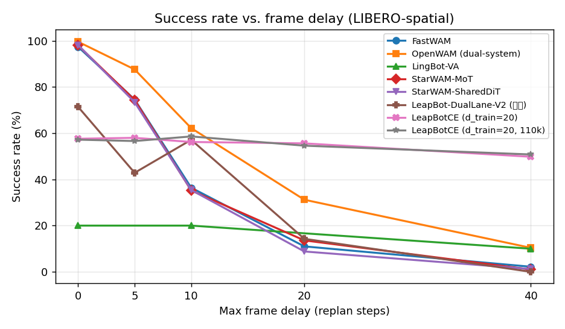

# Baseline 帧延迟鲁棒性评测 — 实时结果

> 自动生成于 **2026-10-01 15:11:26** · 生成器 `FastWAM/docs/generate_baseline_report.py`
> 刷新: `python FastWAM/docs/generate_baseline_report.py`（可随时重复执行，新结果目录自动纳入）

**协议**（对齐 CloudEdgeVLA 的 frame-delay 设定）：单流全观测帧延迟。每次 replan 从 `seed=1234` 的 RNG 采样 d∈[0, D]，整组观测同时老化；扫描 D ∈ {0, 5, 10, 20, 40} 步。

**标准协议（对齐各基线官方论文/仓库配置）**：LIBERO-spatial 全部 10 任务 × **50 trials/任务**（=每延迟 500 回合，与各仓库官方默认一致：FastWAM `sim_libero.yaml num_trials:50`、StarWAM launch 默认 50、LingBot client `--test-num 50`、OpenWAM scheduler canonical 50）。在此之上叠加帧延迟扫描。表格单元格若标注 (n=k) 为进行中/pilot 数据（k<500），**加粗 = 论文标准规模（n≥500/延迟）**。

### 官方配置对照

| 基线 | 官方 trials/任务 | 本评测推理配置 | 备注 |
|---|---|---|---|
| FastWAM | 50 | num_inference_steps=10, replan=10 | 官方 release ckpt (libero_uncond_2cam224) |
| StarWAM-MoT | 50 | inference=8, action=8, replan=10, wait=10 | 官方 recipe starwam_libero_mot_wan22_5b |
| StarWAM-SharedDiT | 50 | inference=16, action=16, replan=10 | 官方 recipe shared_dit_wan22_5b |
| LingBot-VA | 50 | 官方 libero server 配置 | server+client 官方流程 |
| OpenWAM (dual-system) | 50 | eef native action, seed42 settle30 协议 | scheduler canonical |
| Kairos † | LIBERO-Plus 类目协议 | external WAM adapter (DiT 4B+Qwen2.5-VL-7B) | Camera Viewpoints 60 任务子集×1 trial（全类目 1599） |
| LeapBot-DualLane-V2 (在研) | 50 | inference=20, replan=10, wait=30 | dual-lane 双流在研模型 |
| LeapBotCE (d_train=20) | 50 | inference=10, replan=10, wait=30 | 本仓库训练，全 LIBERO 四套件 50k 步，seed=1234 |
| LeapBotCE (d_train=20, 110k) | 50 | inference=10, replan=10, wait=30 | 本仓库训练，d_train=20 加长轮在 110k 步（200k 计划中途，NCCL 崩溃前最后检查点）的评测，seed=1234 |
| LeapBotCE (d_train=20, 200k) | 50 | inference=10, replan=10, wait=30 | 本仓库训练，d_train=20 加长轮完整 200k 步（若后续续训完成） |
| LeapBotCE (d_train=40) | 50 | inference=10, replan=10, wait=30 | 同上，训练时延上限 40 |

## 主表：各方法成功率 (%) 对比 — 每个方法一行

**LIBERO-spatial，按帧延迟扫描。单元格 = 成功率 (%)；每格数据取该延迟下回合数最多的运行（n 标注见下）**

| 方法 | 延迟 0 | 延迟 5 | 延迟 10 | 延迟 20 | 延迟 40 |
|---|---|---|---|---|---|
| FastWAM | **97.4** | **74.6** | **36.4** | **11.0** | **2.2** |
| OpenWAM (dual-system) | **99.6** | **87.6** | **62.2** | **31.2** | **10.4** |
| LingBot-VA | 20.0(n=10) | — | 20.0(n=10) | — | 10.0(n=10) |
| StarWAM-MoT | **98.0** | **74.4** | **35.2** | **13.6** | **1.0** |
| StarWAM-SharedDiT | **98.2** | **73.4** | **35.4** | **8.8** | **1.2** |
| Kairos † | — | — | — | — | — |
| LeapBot-DualLane-V2 (在研) | 71.4(n=7) | 42.9(n=7) | 57.1(n=7) | 14.3(n=7) | 0.0(n=7) |
| LeapBotCE (d_train=20) | — | — | — | — | — |
| LeapBotCE (d_train=20, 110k) | — | — | — | — | — |
| LeapBotCE (d_train=20, 200k) | — | — | — | — | — |
| LeapBotCE (d_train=40) | — | — | — | — | — |

加粗 = 论文标准规模 (n=500/延迟，即 10 任务×50 trials)。`(n=k)` = 该延迟只有 k 回合（pilot/链路验证）。`—` = 该延迟尚未有结果。
† Kairos 在其原生基准 LIBERO-Plus (Camera Viewpoints 类目) 上评测，与其他方法的 libero_spatial 不完全可比。

### 帧延迟协议实现备注（CloudEdgeVLA 式单流全观测老化）

**核心保证：所有方法的延迟均作用于完整观测流（图像 + 本体状态 + 全部模态一起老化），模拟云端部署时整包观测的网络老化；不存在只延迟图像的实现。** 每次 replan 采样一个延迟 d，取 d 步之前的完整观测 dict 交给策略。逐方法核查（代码路径相对各自仓库根目录）：

| 方法 | 延迟实现 | 机制 | 采样区间 |
|---|---|---|---|
| FastWAM | `experiments/libero/eval_libero_delayed.py` + `experiments/libero/cloudedge_delay.py` | `history.append(obs)` 存 env 完整观测 dict → `delayed_obs` 整体传 `_predict_action_chunk`；results 标注 `delay_protocol: single_stream_full_observation` | U{1..D} |
| StarWAM-MoT/SharedDiT | `examples/libero/rollout.py`（`history.append(obs)` → `_predict_action_chunk(obs=delayed_obs)`） | env 原始 obs 全量入 deque | U{1..D} |
| OpenWAM (dual-system) | `benchmarks/libero/single_eval.py`（`_snapshot_observation` deep-copy 全 dict → `policy.act(delayed_obs)`，`send_state=True`） | 图像+状态全模态在延迟载荷内 | U{0..D} |
| LeapBot-DualLane-V2 | `experiments/liberoplus/eval_liberoplus_dual_lane_fixed.py`（env wrapper 每次 step `copy.deepcopy(obs)` 入史，replan 时整体替换） | docstring："Delay the whole synchronized observation at every model replan" | U{0..D} |
| LingBot-VA | `evaluation/libero/client_delay.py`（`deque([obs])` → `model.infer(dict(obs=delayed_obs, prompt))`） | 完整观测上送 | U{1..D} |
| Kairos | `benchmarks/libero_plus/kairos_wam/experiments/libero/eval_libero_single.py`（同 OpenWAM snapshot 模式 → `_predict_action_chunk(obs=model_obs)`） | 全 dict 深拷贝入史 | U{0..D} |
| LeapBotCE | `experiments/libero/eval_libero_cloudedge.py` + `experiments/libero/cloudedge_delay.py` | **云端/边缘分流协议（方法原生设计）**：仅云端流老化——cloud 相机拼接图 + cloud 本体状态取自同一 t-d 历史条目，经冻结 Wan 编码为规划 KV；边缘当前双视角（SigLIP）与当前本体状态始终新鲜，仅在 ActionDiT 注入 | U{1..min(D,h)} |

**观测契约披露（重要）**：与上表单流全观测老化的基线不同，LeapBotCE 的延迟只作用于云端规划观测（图像+本体状态同源老化），边缘侧当前视角/本体状态保持新鲜——这是该方法的云边分工设计本身，评测如实按其原生协议执行。对比两条曲线时需注明：LeapBotCE 在延迟 D 下仍持有 D 步内新鲜的边缘观测，而基线的全观测已老化 D 步；因此 LeapBotCE 的保持率优势来自"新鲜边缘补偿"，论文引用时必须声明该契约差异（LEAPBOTCE.md 基线协议第 5 条）。

**采样区间披露**：OpenWAM / LeapBot / Kairos 为 U{0..D}（采到 0 = 本次 replan 用即时观测）；FastWAM / StarWAM / LingBot / LeapBotCE 为 U{1..D}（每次 replan 至少老化 1 步；LeapBotCE 的上限为 min(D, 已有历史)，回合初期历史不足时回退当前帧）。D≥5 时两种区间均值差 <0.5 步，不影响方向性结论；论文按上表如实标注即可。公共参数：`delay_seed=1234`（LeapBotCE 以 cfg.seed=1234 为延迟/动作 RNG 基），D ∈ {0,5,10,20,40}，replan 每 10 步。
**审计链**：每个 trial 的 realized delay（`delay_samples`）、`delay_mean` 与 `delay_histogram` 均落盘于各自 results.json，可直接引用作论文协议证明。

- **FastWAM**: n 按延迟取最多回合的来源：{0: (500, 'libero_spatial (+50t-20260919)'), 5: (500, 'libero_spatial (+50t-20260919)'), 10: (500, 'libero_spatial (+50t-20260919)'), 20: (500, 'libero_spatial (+50t-20260919)'), 40: (500, 'libero_spatial (+50t-20260919)')}；来源运行：libero_spatial (+50t-20260919)
- **OpenWAM (dual-system)**: n 按延迟取最多回合的来源：{0: (500, 'libero-spatial-50t-20260919'), 10: (500, 'libero-spatial-50t-20260919'), 20: (500, 'libero-spatial-50t-20260919'), 40: (500, 'libero-spatial-50t-20260919'), 5: (500, 'libero-spatial-50t-20260919')}；来源运行：libero-spatial-50t-20260919
- **LingBot-VA**: n 按延迟取最多回合的来源：{0: (10, 'libero-spatial-full-20260919'), 10: (10, 'libero-spatial-full-20260919'), 40: (10, 'libero-spatial-full-20260919')}；来源运行：libero-spatial-full-20260919
- **StarWAM-MoT**: n 按延迟取最多回合的来源：{0: (500, 'libero-spatial-mot-50t-20260919'), 10: (500, 'libero-spatial-mot-50t-20260919'), 20: (500, 'libero-spatial-mot-50t-20260919'), 40: (500, 'libero-spatial-mot-50t-20260919'), 5: (500, 'libero-spatial-mot-50t-20260919')}；来源运行：libero-spatial-mot-50t-20260919
- **StarWAM-SharedDiT**: n 按延迟取最多回合的来源：{0: (500, 'libero-spatial-sharedit-50t-20260919'), 10: (500, 'libero-spatial-sharedit-50t-20260919'), 20: (500, 'libero-spatial-sharedit-50t-20260919'), 40: (500, 'libero-spatial-sharedit-50t-20260919'), 5: (500, 'libero-spatial-sharedit-50t-20260919')}；来源运行：libero-spatial-sharedit-50t-20260919
- **LeapBot-DualLane-V2 (在研)**: n 按延迟取最多回合的来源：{0: (7, 'lb-dual-full-20260919'), 10: (7, 'lb-dual-full-20260919'), 20: (7, 'lb-dual-full-20260919'), 40: (7, 'lb-dual-full-20260919'), 5: (7, 'lb-dual-full-20260919')}；来源运行：lb-dual-full-20260919


## LIBERO-object（帧延迟扫描，同协议：delay_seed=1234，replan=10，D∈{0,5,10,20,40}）

| 方法 | 延迟 0 | 延迟 5 | 延迟 10 | 延迟 20 | 延迟 40 |
|---|---|---|---|---|---|
| FastWAM | **99.4** | **91.0** | **43.8** | **2.6** | **0.0** |
| OpenWAM (dual-system) | **99.8** | **97.2** | **91.2** | **64.2** | **10.6** |
| StarWAM-MoT | **99.0** | **92.0** | **49.0** | **7.4** | **0.0** |
| StarWAM-SharedDiT | **99.8** | **92.8** | **71.0** | **24.8** | **0.2** |

加粗 = 论文标准规模 (n=500/延迟，即 10 任务×50 trials)；`(n=k)` = 该延迟只有 k 回合（进行中/pilot）。
- **FastWAM**: n 按延迟取最多回合的来源：{0: (500, '50t-20260919'), 10: (500, '50t-20260919'), 20: (500, '50t-20260919'), 40: (500, '50t-20260919'), 5: (500, '50t-20260919')}；来源运行：50t-20260919
- **OpenWAM (dual-system)**: n 按延迟取最多回合的来源：{0: (500, 'libero-object-50t-20260920'), 10: (500, 'libero-object-50t-20260920'), 20: (500, 'libero-object-50t-20260920'), 40: (500, 'libero-object-50t-20260920'), 5: (500, 'libero-object-50t-20260920')}；来源运行：libero-object-50t-20260920
- **StarWAM-MoT**: n 按延迟取最多回合的来源：{0: (500, 'libero-object-mot-50t-20260920'), 10: (500, 'libero-object-mot-50t-20260920'), 20: (500, 'libero-object-mot-50t-20260920'), 40: (500, 'libero-object-mot-50t-20260920'), 5: (500, 'libero-object-mot-50t-20260920')}；来源运行：libero-object-mot-50t-20260920
- **StarWAM-SharedDiT**: n 按延迟取最多回合的来源：{0: (500, 'libero-object-sharedit-50t-20260920'), 10: (500, 'libero-object-sharedit-50t-20260920'), 20: (500, 'libero-object-sharedit-50t-20260920'), 40: (500, 'libero-object-sharedit-50t-20260920'), 5: (500, 'libero-object-sharedit-50t-20260920')}；来源运行：libero-object-sharedit-50t-20260920

## LIBERO-goal（帧延迟扫描，同协议：delay_seed=1234，replan=10，D∈{0,5,10,20,40}）

| 方法 | 延迟 0 | 延迟 5 | 延迟 10 | 延迟 20 | 延迟 40 |
|---|---|---|---|---|---|
| FastWAM | **97.2** | **86.0** | **61.6** | **29.2** | **8.2** |
| OpenWAM (dual-system) | **98.8** | **92.6** | **81.4** | **56.4** | **26.0** |
| StarWAM-MoT | **98.4** | **83.0** | **56.2** | **31.2** | **9.8** |
| StarWAM-SharedDiT | **98.2** | **85.2** | **63.0** | **36.0** | **11.2** |

加粗 = 论文标准规模 (n=500/延迟，即 10 任务×50 trials)；`(n=k)` = 该延迟只有 k 回合（进行中/pilot）。
- **FastWAM**: n 按延迟取最多回合的来源：{0: (500, '50t-20260919'), 10: (500, '50t-20260919'), 20: (500, '50t-20260919'), 40: (500, '50t-20260919'), 5: (500, '50t-20260919')}；来源运行：50t-20260919
- **OpenWAM (dual-system)**: n 按延迟取最多回合的来源：{0: (500, 'libero-goal-50t-20260920'), 10: (500, 'libero-goal-50t-20260920'), 20: (500, 'libero-goal-50t-20260920'), 40: (500, 'libero-goal-50t-20260920'), 5: (500, 'libero-goal-50t-20260920')}；来源运行：libero-goal-50t-20260920
- **StarWAM-MoT**: n 按延迟取最多回合的来源：{0: (500, 'libero-goal-mot-50t-20260920'), 10: (500, 'libero-goal-mot-50t-20260920'), 20: (500, 'libero-goal-mot-50t-20260920'), 40: (500, 'libero-goal-mot-50t-20260920'), 5: (500, 'libero-goal-mot-50t-20260920')}；来源运行：libero-goal-mot-50t-20260920
- **StarWAM-SharedDiT**: n 按延迟取最多回合的来源：{0: (500, 'libero-goal-sharedit-50t-20260920'), 10: (500, 'libero-goal-sharedit-50t-20260920'), 20: (500, 'libero-goal-sharedit-50t-20260920'), 40: (500, 'libero-goal-sharedit-50t-20260920'), 5: (500, 'libero-goal-sharedit-50t-20260920')}；来源运行：libero-goal-sharedit-50t-20260920

## LIBERO-10（帧延迟扫描，同协议：delay_seed=1234，replan=10，D∈{0,5,10,20,40}）

| 方法 | 延迟 0 | 延迟 5 | 延迟 10 | 延迟 20 | 延迟 40 |
|---|---|---|---|---|---|
| FastWAM | **94.4** | **75.6** | **36.8** | **7.4** | **0.4** |
| OpenWAM (dual-system) | **98.6** | **91.2** | **73.6** | **34.6** | **6.4** |
| StarWAM-MoT | **94.0** | **79.0** | **41.4** | **8.4** | **0.8** |
| StarWAM-SharedDiT | **97.0** | **80.0** | **55.0** | **12.2** | **1.0** |

加粗 = 论文标准规模 (n=500/延迟，即 10 任务×50 trials)；`(n=k)` = 该延迟只有 k 回合（进行中/pilot）。
- **FastWAM**: n 按延迟取最多回合的来源：{0: (500, '50t-20260920'), 10: (500, '50t-20260920'), 20: (500, '50t-20260920'), 40: (500, '50t-20260920'), 5: (500, '50t-20260920')}；来源运行：50t-20260920
- **OpenWAM (dual-system)**: n 按延迟取最多回合的来源：{0: (500, 'libero_10-50t-20260920'), 10: (500, 'libero_10-50t-20260920'), 20: (500, 'libero_10-50t-20260920'), 40: (500, 'libero_10-50t-20260920'), 5: (500, 'libero_10-50t-20260920')}；来源运行：libero_10-50t-20260920
- **StarWAM-MoT**: n 按延迟取最多回合的来源：{0: (500, 'libero_10-mot-50t-20260920'), 10: (500, 'libero_10-mot-50t-20260920'), 20: (500, 'libero_10-mot-50t-20260920'), 40: (500, 'libero_10-mot-50t-20260920'), 5: (500, 'libero_10-mot-50t-20260920')}；来源运行：libero_10-mot-50t-20260920
- **StarWAM-SharedDiT**: n 按延迟取最多回合的来源：{0: (500, 'libero_10-sharedit-50t-20260920'), 10: (500, 'libero_10-sharedit-50t-20260920'), 20: (500, 'libero_10-sharedit-50t-20260920'), 40: (500, 'libero_10-sharedit-50t-20260920'), 5: (500, 'libero_10-sharedit-50t-20260920')}；来源运行：libero_10-sharedit-50t-20260920

## 对比曲线



## 进行中 / 待办 / 阻塞

**Tier-3 论文标准（10 任务 × 50 trials × 5 delay = 每格 500 回合）**，4 个 LIBERO 子任务套件 × 各方法：
- **LIBERO-spatial**：FastWAM ✅ / StarWAM-MoT ✅ / StarWAM-SharedDiT ✅ / OpenWAM 仅剩 d40（在跑）/ LingBot·LeapBot 为 pilot 规模（n=10/7，见主表标注）/ Kairos 走 LIBERO-Plus 类目协议（已完成 60 任务子集 × 5 delay）。
- **LIBERO-object**：FastWAM d0/d5/d40 ✅，d10/d20 在跑；StarWAM-MoT 5 delay + SharedDiT d0 + OpenWAM 5 delay 全部在跑（2026-09-20 起密集共卡调度）。
- **LIBERO-goal**：FastWAM 5 delay 全部在跑。
- **LIBERO-10**：FastWAM 5 delay 在跑；StarWAM / OpenWAM 排队接力。
- **Kairos（⚠️ 协议复核）**：5 delay 均 60/60 = 100%（LIBERO-Plus Camera Viewpoints，n=60/延迟，1 trial/任务）。全延迟零衰减与其他方法的延迟曲线矛盾，且 task_results 无实际延迟统计字段 —— 延迟协议对 Kairos 评测链路的实际生效性待复核，复核通过前不入对比结论。

**调度**：GPU 密集共卡（每卡 2-3 个 eval 共享，显存 50-74GB/卡）；已清除全部 smoke/1-trial 旧结果（归档至 `baseline-evaluations/_archive_smoke_20260920/`）。

**阻塞项**：
- **RoboTwin 系（Motus / StarWAM-RoboTwin / X-WAM / DreamZero / AHA-WAM）**：资产已就位，等用户侧容器重建（NVIDIA_DRIVER_CAPABILITIES 加 graphics）后开始 Motus smoke。
- **DreamZero**：是否纳入 RoboTwin 评测待定。

## 附录：各运行明细

### FastWAM

**libero_spatial (+50t-20260919)** — `/mnt/c2-worldmodel/2653853/baseline-evaluations/fastwam/libero_spatial/50t-20260919`

| delay | 成功/回合 | 成功率 | 实际延迟均值 | replans | 直方图(前几档) |
|---|---|---|---|---|---|
| 0 | 487/500 | 97.4% | 0.00 | 5615 | 0:5615 |
| 5 | 373/500 | 74.6% | 2.97 | 10924 | 1:2246, 2:2183, 3:2172, 4:2255, 5:2068 |
| 10 | 182/500 | 36.4% | 5.54 | 16667 | 1:1813, 2:1566, 3:1652, 4:1664, 5:1562 …(+5档) |
| 20 | 55/500 | 11.0% | 10.66 | 19346 | 1:1001, 2:859, 3:892, 4:970, 5:874 …(+15档) |
| 40 | 11/500 | 2.2% | 20.52 | 19957 | 1:590, 2:380, 3:450, 4:490, 5:430 …(+35档) |

**50t-20260920** — `/mnt/c2-worldmodel/2653853/baseline-evaluations/fastwam/libero_10/50t-20260920`

| delay | 成功/回合 | 成功率 | 实际延迟均值 | replans | 直方图(前几档) |
|---|---|---|---|---|---|
| 0 | 472/500 | 94.4% | 0.00 | — | 0:13688 |
| 5 | 378/500 | 75.6% | 2.96 | — | 1:4295, 2:4046, 3:4112, 4:4145, 5:3925 |
| 10 | 184/500 | 36.8% | 5.49 | — | 1:3134, 2:2867, 3:2878, 4:3013, 5:2797 …(+5档) |
| 20 | 37/500 | 7.4% | 10.59 | — | 1:1784, 2:1626, 3:1543, 4:1688, 5:1619 …(+15档) |
| 40 | 2/500 | 0.4% | 20.47 | — | 1:988, 2:750, 3:810, 4:910, 5:770 …(+35档) |

**50t-20260919** — `/mnt/c2-worldmodel/2653853/baseline-evaluations/fastwam/libero_goal/50t-20260919`

| delay | 成功/回合 | 成功率 | 实际延迟均值 | replans | 直方图(前几档) |
|---|---|---|---|---|---|
| 0 | 486/500 | 97.2% | 0.00 | — | 0:5883 |
| 5 | 430/500 | 86.0% | 2.96 | — | 1:1868, 2:1848, 3:1774, 4:1873, 5:1693 |
| 10 | 308/500 | 61.6% | 5.57 | — | 1:1413, 2:1194, 3:1276, 4:1324, 5:1195 …(+5档) |
| 20 | 146/500 | 29.2% | 10.65 | — | 1:886, 2:750, 3:813, 4:878, 5:790 …(+15档) |
| 40 | 41/500 | 8.2% | 20.53 | — | 1:570, 2:366, 3:435, 4:479, 5:415 …(+35档) |

**50t-20260919** — `/mnt/c2-worldmodel/2653853/baseline-evaluations/fastwam/libero_object/50t-20260919`

| delay | 成功/回合 | 成功率 | 实际延迟均值 | replans | 直方图(前几档) |
|---|---|---|---|---|---|
| 0 | 497/500 | 99.4% | 0.00 | — | 0:6658 |
| 5 | 455/500 | 91.0% | 2.97 | — | 1:2040, 2:2035, 3:1962, 4:2098, 5:1862 |
| 10 | 219/500 | 43.8% | 5.55 | — | 1:1851, 2:1554, 3:1681, 4:1680, 5:1569 …(+5档) |
| 20 | 13/500 | 2.6% | 10.67 | — | 1:1020, 2:868, 3:917, 4:1007, 5:916 …(+15档) |
| 40 | 0/500 | 0.0% | 20.53 | — | 1:590, 2:380, 3:450, 4:490, 5:430 …(+35档) |

### OpenWAM (dual-system)

**libero-spatial-50t-20260919** — `/mnt/c2-worldmodel/2653853/baseline-evaluations/openwam/libero-spatial-50t-20260919`

| delay | 成功/回合 | 成功率 | 实际延迟均值 | replans | 直方图(前几档) |
|---|---|---|---|---|---|
| 0 | 498/500 | 99.6% | — | — |  |
| 5 | 438/500 | 87.6% | — | — |  |
| 10 | 311/500 | 62.2% | — | — |  |
| 20 | 156/500 | 31.2% | — | — |  |
| 40 | 52/500 | 10.4% | — | — |  |

**libero-goal-50t-20260920** — `/dahuafs/userdata/2653853/code/OpenWAM/openwam/libero-goal-50t-20260920`

| delay | 成功/回合 | 成功率 | 实际延迟均值 | replans | 直方图(前几档) |
|---|---|---|---|---|---|
| 0 | 494/500 | 98.8% | — | — |  |
| 5 | 463/500 | 92.6% | — | — |  |
| 10 | 407/500 | 81.4% | — | — |  |
| 20 | 282/500 | 56.4% | — | — |  |
| 40 | 130/500 | 26.0% | — | — |  |

**libero-object-50t-20260920** — `/dahuafs/userdata/2653853/code/OpenWAM/openwam/libero-object-50t-20260920`

| delay | 成功/回合 | 成功率 | 实际延迟均值 | replans | 直方图(前几档) |
|---|---|---|---|---|---|
| 0 | 499/500 | 99.8% | — | — |  |
| 5 | 486/500 | 97.2% | — | — |  |
| 10 | 456/500 | 91.2% | — | — |  |
| 20 | 321/500 | 64.2% | — | — |  |
| 40 | 53/500 | 10.6% | — | — |  |

**libero_10-50t-20260920** — `/dahuafs/userdata/2653853/code/OpenWAM/openwam/libero_10-50t-20260920`

| delay | 成功/回合 | 成功率 | 实际延迟均值 | replans | 直方图(前几档) |
|---|---|---|---|---|---|
| 0 | 493/500 | 98.6% | — | — |  |
| 5 | 456/500 | 91.2% | — | — |  |
| 10 | 368/500 | 73.6% | — | — |  |
| 20 | 173/500 | 34.6% | — | — |  |
| 40 | 32/500 | 6.4% | — | — |  |

### LingBot-VA

**libero-spatial-full-20260919** — `/mnt/c2-worldmodel/2653853/baseline-evaluations/lingbot-va/libero-spatial-full-20260919`

| delay | 成功/回合 | 成功率 | 实际延迟均值 | replans | 直方图(前几档) |
|---|---|---|---|---|---|
| 0 | 2/10 | 20.0% | 0.00 | 429 | 0:429 |
| 5 | — | — | — | — | — |
| 10 | 2/10 | 20.0% | 5.39 | 438 | 0:10, 1:60, 2:42, 3:26, 4:51 …(+6档) |
| 20 | — | — | — | — | — |
| 40 | 1/10 | 10.0% | 18.30 | 463 | 0:10, 1:9, 2:9, 3:9, 4:28 …(+27档) |

### StarWAM-MoT

**libero-goal-mot-50t-20260920** — `/mnt/c2-worldmodel/2653853/baseline-evaluations/starwam/libero-goal-mot-50t-20260920`

| delay | 成功/回合 | 成功率 | 实际延迟均值 | replans | 直方图(前几档) |
|---|---|---|---|---|---|
| 0 | 492/500 | 98.4% | 0.00 | 6002 | 0:6002 |
| 5 | 415/500 | 83.0% | 2.97 | 9617 | 1:1983, 2:1934, 3:1897, 4:2034, 5:1769 |
| 10 | 281/500 | 56.2% | 5.55 | 13697 | 1:1502, 2:1286, 3:1321, 4:1406, 5:1226 …(+5档) |
| 20 | 156/500 | 31.2% | 10.49 | 17163 | 1:942, 2:776, 3:811, 4:908, 5:835 …(+15档) |
| 40 | 49/500 | 9.8% | 19.87 | 19360 | 1:651, 2:415, 3:474, 4:517, 5:472 …(+35档) |

**libero-object-mot-50t-20260920** — `/mnt/c2-worldmodel/2653853/baseline-evaluations/starwam/libero-object-mot-50t-20260920`

| delay | 成功/回合 | 成功率 | 实际延迟均值 | replans | 直方图(前几档) |
|---|---|---|---|---|---|
| 0 | 495/500 | 99.0% | 0.00 | 7130 | 0:7130 |
| 5 | 460/500 | 92.0% | 2.96 | 10236 | 1:2136, 2:2068, 3:2026, 4:2129, 5:1877 |
| 10 | 245/500 | 49.0% | 5.55 | 16832 | 1:1848, 2:1553, 3:1677, 4:1673, 5:1529 …(+5档) |
| 20 | 37/500 | 7.4% | — | — |  |
| 40 | 0/500 | 0.0% | — | — |  |

**libero-spatial-mot-50t-20260919** — `/mnt/c2-worldmodel/2653853/baseline-evaluations/starwam/libero-spatial-mot-50t-20260919`

| delay | 成功/回合 | 成功率 | 实际延迟均值 | replans | 直方图(前几档) |
|---|---|---|---|---|---|
| 0 | 490/500 | 98.0% | 0.00 | 5795 | 0:5795 |
| 5 | 372/500 | 74.4% | 2.97 | 11067 | 1:2264, 2:2254, 3:2198, 4:2245, 5:2106 |
| 10 | 176/500 | 35.2% | 5.54 | 16737 | 1:1818, 2:1564, 3:1678, 4:1650, 5:1568 …(+5档) |
| 20 | 68/500 | 13.6% | 10.54 | 19214 | 1:1032, 2:864, 3:889, 4:1011, 5:896 …(+15档) |
| 40 | 5/500 | 1.0% | 19.86 | 19968 | 1:668, 2:430, 3:490, 4:530, 5:489 …(+35档) |

**libero_10-mot-50t-20260920** — `/mnt/c2-worldmodel/2653853/baseline-evaluations/starwam/libero_10-mot-50t-20260920`

| delay | 成功/回合 | 成功率 | 实际延迟均值 | replans | 直方图(前几档) |
|---|---|---|---|---|---|
| 0 | 470/500 | 94.0% | 0.00 | 14483 | 0:14483 |
| 5 | 395/500 | 79.0% | 2.97 | 20434 | 1:4267, 2:4008, 3:4073, 4:4158, 5:3928 |
| 10 | 207/500 | 41.4% | 5.49 | 28733 | 1:3085, 2:2798, 3:2814, 4:2957, 5:2726 …(+5档) |
| 20 | 42/500 | 8.4% | 10.53 | 34005 | 1:1812, 2:1626, 3:1549, 4:1723, 5:1652 …(+15档) |
| 40 | 4/500 | 0.8% | 20.11 | 34947 | 1:1080, 2:819, 3:850, 4:936, 5:819 …(+35档) |

### StarWAM-SharedDiT

**libero-goal-sharedit-50t-20260920** — `/mnt/c2-worldmodel/2653853/baseline-evaluations/starwam-sharedit/libero-goal-sharedit-50t-20260920`

| delay | 成功/回合 | 成功率 | 实际延迟均值 | replans | 直方图(前几档) |
|---|---|---|---|---|---|
| 0 | 491/500 | 98.2% | — | — |  |
| 5 | 426/500 | 85.2% | — | — |  |
| 10 | 315/500 | 63.0% | 5.57 | 12882 | 1:1410, 2:1172, 3:1247, 4:1303, 5:1185 …(+5档) |
| 20 | 180/500 | 36.0% | 10.50 | 16433 | 1:904, 2:744, 3:785, 4:866, 5:781 …(+15档) |
| 40 | 56/500 | 11.2% | 19.83 | 18976 | 1:650, 2:411, 3:469, 4:511, 5:461 …(+35档) |

**libero-object-sharedit-50t-20260920** — `/mnt/c2-worldmodel/2653853/baseline-evaluations/starwam-sharedit/libero-object-sharedit-50t-20260920`

| delay | 成功/回合 | 成功率 | 实际延迟均值 | replans | 直方图(前几档) |
|---|---|---|---|---|---|
| 0 | 499/500 | 99.8% | 0.00 | 6823 | 0:6823 |
| 5 | 464/500 | 92.8% | 2.96 | 9570 | 1:1993, 2:1926, 3:1886, 4:2000, 5:1765 |
| 10 | 355/500 | 71.0% | 5.55 | 14246 | 1:1564, 2:1320, 3:1414, 4:1416, 5:1288 …(+5档) |
| 20 | 124/500 | 24.8% | 10.54 | 19037 | 1:1023, 2:856, 3:873, 4:1003, 5:886 …(+15档) |
| 40 | 1/500 | 0.2% | 19.86 | 19991 | 1:670, 2:429, 3:490, 4:529, 5:490 …(+35档) |

**libero-spatial-sharedit-50t-20260919** — `/mnt/c2-worldmodel/2653853/baseline-evaluations/starwam-sharedit/libero-spatial-sharedit-50t-20260919`

| delay | 成功/回合 | 成功率 | 实际延迟均值 | replans | 直方图(前几档) |
|---|---|---|---|---|---|
| 0 | 491/500 | 98.2% | 0.00 | 5687 | 0:5687 |
| 5 | 367/500 | 73.4% | 2.97 | 11138 | 1:2269, 2:2255, 3:2208, 4:2306, 5:2100 |
| 10 | 177/500 | 35.4% | 5.56 | 16631 | 1:1801, 2:1540, 3:1659, 4:1619, 5:1558 …(+5档) |
| 20 | 44/500 | 8.8% | 10.55 | 19411 | 1:1038, 2:867, 3:901, 4:1017, 5:909 …(+15档) |
| 40 | 6/500 | 1.2% | 19.86 | 19920 | 1:668, 2:430, 3:490, 4:529, 5:486 …(+35档) |

**libero_10-sharedit-50t-20260920** — `/mnt/c2-worldmodel/2653853/baseline-evaluations/starwam-sharedit/libero_10-sharedit-50t-20260920`

| delay | 成功/回合 | 成功率 | 实际延迟均值 | replans | 直方图(前几档) |
|---|---|---|---|---|---|
| 0 | 485/500 | 97.0% | 0.00 | 13427 | 0:13427 |
| 5 | 400/500 | 80.0% | — | — |  |
| 10 | 275/500 | 55.0% | 5.50 | 26152 | 1:2785, 2:2567, 3:2541, 4:2656, 5:2463 …(+5档) |
| 20 | 61/500 | 12.2% | 10.53 | 33251 | 1:1765, 2:1595, 3:1519, 4:1690, 5:1624 …(+15档) |
| 40 | 5/500 | 1.0% | 20.11 | 34893 | 1:1077, 2:817, 3:850, 4:938, 5:818 …(+35档) |

### Kairos

**libero-plus-camera-viewpoints-60t** — `/mnt/c2-worldmodel/2653853/baseline-evaluations/kairos/libero_plus`

| delay | 成功/回合 | 成功率 | 实际延迟均值 | replans | 直方图(前几档) |
|---|---|---|---|---|---|
| 0 | 60/60 | 100.0% | — | — |  |
| 5 | 60/60 | 100.0% | — | — |  |
| 10 | 60/60 | 100.0% | — | — |  |
| 20 | 60/60 | 100.0% | — | — |  |
| 40 | 60/60 | 100.0% | — | — |  |

### LeapBot-DualLane-V2

**lb-dual-full-20260919** — `/mnt/c2-worldmodel/2653853/baseline-evaluations/leapbot-dual-lane-v2-full-20260919`

| delay | 成功/回合 | 成功率 | 实际延迟均值 | replans | 直方图(前几档) |
|---|---|---|---|---|---|
| 0 | 5/7 | 71.4% | 0.00 | — | 0:186 |
| 5 | 3/7 | 42.9% | 2.46 | — | 0:47, 1:57, 2:42, 3:58, 4:64 …(+1档) |
| 10 | 4/7 | 57.1% | 5.16 | — | 0:36, 1:26, 2:22, 3:31, 4:15 …(+6档) |
| 20 | 1/7 | 14.3% | 11.49 | — | 0:12, 1:6, 2:19, 3:13, 5:32 …(+15档) |
| 40 | 0/7 | 0.0% | 19.15 | — | 0:7, 1:7, 2:7, 3:21, 4:7 …(+31档) |

## GPU / 进程快照（生成时刻）

```
0, 26565 MiB, 0 %
1, 4 MiB, 0 %
2, 6 MiB, 0 %
3, 6 MiB, 0 %
4, 4 MiB, 0 %
5, 4 MiB, 0 %
6, 4 MiB, 0 %
7, 7807 MiB, 0 %
```
