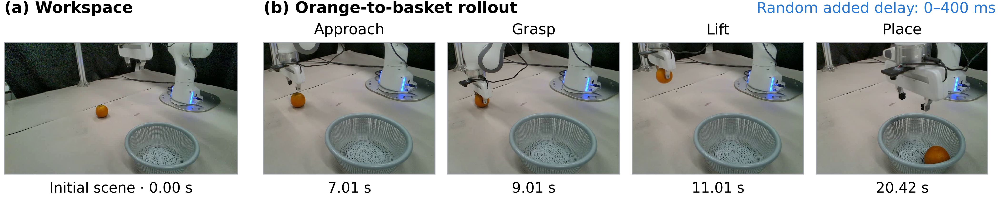

# 真机橙子落筐演示（2026-10-29）

已将用户提供的真机视频整理为论文Fig.4，展示0–400 ms随机额外网络时延条件下的完整橙子抓取落筐过程。时延值由用户确认，图文使用“random additional network delay within 0–400 ms”，没有将其改称单向时延或RTT。



左侧为初始工作区，右侧依次为接近、抓取、抬起、放入筐中。所有画面来自同一段20.52 s、205帧的视频；图中时间为视频经过时间，不是网络事务或模型阶段时延。

| 画面 | 帧索引（从0起） | 视频时间 s | 显示范围 |
|---|---:|---:|---|
| 初始工作区 | 0 | 0.00 | 完整960×540 |
| 接近 | 70 | 7.01 | 统一裁剪600×460 |
| 抓取 | 90 | 9.01 | 同上 |
| 抬起 | 110 | 11.01 | 同上 |
| 放入筐中 | 204 | 20.42 | 同上 |

原视频SHA256为`89f2435652d2d13bb341a8a39197b62a19fa9a615b1f4f56e87104932d760d41`。
完整原始帧、逐帧哈希与裁剪参数在论文仓库`Figures/assets/realrobot/`；本报告旁保存[元数据副本](assets/testbed_20261029/realrobot_demo_manifest.json)。裁剪框为`(280,80,880,540)`，四帧完全相同。未调整亮度、对比度、颜色、物体或背景。

该视频支持“0–400 ms随机额外网络时延下完成了所示物理操作”的定性论述。不同延迟下的试验总数和成功次数未提供，本轮没有据此计算成功率或绘制成功率曲线。性能测试的时延/吞吐统计仍来自固定观测回放，与本次任务演示分别记录。

论文复现命令：

```bash
python Figures/make_realrobot_figure.py
```

脚本使用仓库内完整原始帧，导出7×1.43英寸PDF/SVG及600 dpi PNG，不依赖集群挂载或原视频路径。字体、几何对齐、PDF文字大小和碰撞检查归档于`Figures/qa/realrobot/`；最终论文图形编号为Fig.4，文件保留历史命名`fig6_realrobot`。
