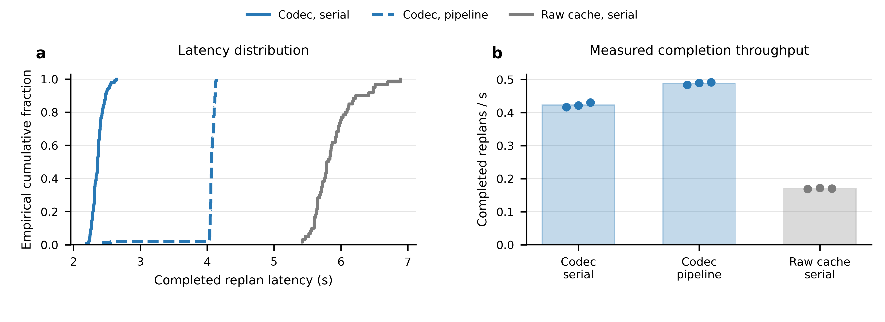

# LeapBot-CE 云端—Jetson 时延与吞吐量实测（2026-10-29）

## Material Passport
- 模式：experiment-agent run；scope：真机硬件推理、HTTP 载荷通信和完成吞吐。
- 原始记录：`deploy_cloudedge/results/testbed_20261029/`；时区 Asia/Shanghai。
- 实验单元：固定两主机、固定输入的技术重复；分三轮，不将重复请求视为独立机器人任务。
- 权重、代码和环境来源：`performance_model_provenance.json`、`code_provenance.json`、`dependencies_jetson.json`；详见 `performance_model_20261029.md` 与 `jetson_preflight_20261029.md`。

## 硬件与部署

云端 aihub 使用 RTX 4090 D 48GB GPU0。另一既有进程占用约14.7GB，但在预检时GPU利用率为0；保持该进程运行，并记录本轮利用率/内存监控。边端是 Jetson AGX Orin Developer Kit **32GB**，现有 MODE_50W、schedutil，不改电源模式。连接为校园 Wi-Fi，aihub实际可达地址10.7.140.45，Jetson地址10.7.136.8；旧aihub有线地址10.7.0.131不可达。

代码维护在用户指定的共享盘；环境维护根在Jetson视角`/data_pdj/daojie/envs/leapbotce/`，按aarch64和x86_64分开。系统和旧环境不写入新依赖，复用已有CUDA/Python运行时。CIFS不支持直接exec/symlink且逐文件导入很慢，运行时使用共享源tar快照的本地`/tmp/leapbotce_20261029`缓存；模型/依赖传输不计入稳态推理。

## 测量定义

- 结构：30层Wan 5B video expert、rank16 q/k/v/o LoRA、56×3072 planning codec、SigLIP每视图5个token、1.02B action expert；bf16、batch1、32×7动作输出、10步Euler去噪。
- 输入：LIBERO数据集中同一episode的两视图固定回放，预先bilinear缩放至224×224，无JPEG压缩。两个uint8帧的张量载荷301056B；精确HTTP body含LBC1/JSON开销记录在每次请求。
- 客户端实际运行在Jetson，cloud请求走真实Wi-Fi；payload安装及fresh-view step走Jetson localhost。云→客户端→端服务的中继因此只有一次物理跨机下行。
- 每条件三轮：codec串行/两阶段pipeline及cloud-only每轮5次warm-up、50次正式操作；raw串行每轮2次warm-up、20次正式；edge-only每轮5次warm-up、20次正式。共570次正式操作，66次warm-up排除；串行与pipeline分别warm-up。pipeline最多提前一个cloud请求，payload与step严格串行并检查replan_id。
- GPU子段为CUDA events；完整HTTP事务和端到端时延都使用Jetson客户端单一perf_counter。跨机perf_counter绝不相减，也不用NTP制造单向时延。
- 完成吞吐=成功完成操作数/整个正式窗口秒数，保留失败耗时。full模式每操作产出一个32动作块；声明消费10动作/块仅作容量换算，不能称实测机器人控制频率。
- `/download`是独立无模型HTTP载荷测试，记录整次小请求→完整响应事务。`/upload`是大请求→小确认事务。goodput为应用body bits/整组耗时，不能等同物理链路带宽；`iperf3`另报TCP接收端有效吞吐。
- codec张量344064B；raw 30层K/V张量36126720B，精确105×体积比。raw路径的端侧注意力token数也不同；端到端对比是整个接口代价，不将全部差值归因于网络。
- 结果限于性能profiling，不测任务成功率、retention或机械臂运动；后续a6检查点可直接沿用同一测试矩阵。

## 实测网络与载荷事务

前测iperf3（每方向3轮、每轮30s）：端→云均值11.367Mbit/s、范围7.932–13.486；云→端均值86.938Mbit/s、范围85.501–88.145。采用TCP接收端sum_received。结束后同样每方向3×30s：上行均值13.441Mbit/s、范围12.265–14.606；下行均值93.653Mbit/s、范围91.684–95.971。前后合计每方向6轮，上行总范围7.932–14.606、下行85.501–95.971Mbit/s。全部网络复测在模型请求结束、监控小文件复制完成后进行，大模型归档随后才开始。与环境安装/SMB读权重重叠的pilot保留但不入本表；失败的iperf控制会话单独保留并重测。

| HTTP操作 | Body字节 | 三轮合计n | mean ms | p50 ms | p95 ms |
|---|---:|---:|---:|---:|---:|
| download | 1024 | 150 | 10.04 | 8.20 | 17.38 |
| download | 344064 | 150 | 48.78 | 42.86 | 97.33 |
| download | 36126720 | 60 | 3189.58 | 3166.88 | 3435.02 |
| upload | 1024 | 150 | 10.24 | 9.36 | 16.29 |
| upload | 344064 | 150 | 283.64 | 271.98 | 431.55 |

下载事务p50由3166.88ms降至42.86ms，相差73.9倍。载荷字节下降105倍，而事务时延不会同比例缩小，因为小载荷仍有HTTP往返、主机拷贝和无线调度固定成本。codec大小的上传事务p50约272ms，明显慢于下行；因此联合系统还需计入观测上行，不能仅靠下行载荷时延判断replan容量。

所有事务均校验响应字节与状态；本组正式样本零失败。3轮结果按固定条件技术重复理解，表内分位数为合并请求的经验分位数。

## 模型时延与完成吞吐（正式三轮）

全部15组、570次正式操作和66次warm-up完成；正式请求均为HTTP 200，动作输出均为有限值且形状32×7，完整路径的payload/cache id一致。`model_benchmark_validation.json`保存逐文件校验、哈希与流水线实际重叠检查。以下时延是合并正式请求的经验统计，吞吐为三轮各自完成率的算术均值及最小—最大范围。

| 条件 | 正式n | mean ms | p50 ms | p95 ms | 三轮平均完成吞吐 /s | 三轮范围 /s |
|---|---:|---:|---:|---:|---:|---:|
| Codec串行，完整路径 | 150 | 2365.74 | 2362.04 | 2529.14 | 0.42277 | 0.41620–0.43043 |
| Codec流水线，完整路径 | 150 | 4043.06 | 4065.85 | 4122.56 | 0.48864 | 0.48420–0.49195 |
| Raw串行，完整路径 | 60 | 5876.60 | 5800.37 | 6485.91 | 0.17014 | 0.16847–0.17186 |
| 仅边端，固定codec cache | 60 | 2018.94 | 2026.63 | 2035.19 | 0.49532 | 0.49234–0.50035 |
| 仅云端，含跨机HTTP | 150 | 271.33 | 264.48 | 395.75 | 3.70289 | 3.47768–4.07825 |

完整路径的单位为replans/s，边端独立测试为action chunks/s，云端独立测试为cloud encodes/s；三个分母均包含各自完整HTTP事务，不能互称纯GPU容量。完整路径串行从观测打包计时到动作返回，流水线同样从每次观测打包前计时到相应动作返回，包含预取后在边端前排队。



图中的点为每轮完成率，柱为三轮均值，线为范围；左图保留正式请求的完整经验分布。[矢量PDF](assets/testbed_20261029/fig_hardware_profile.pdf)及作图用CSV随图归档。

### 计算子段与HTTP归因

| 子段（ms） | Codec串行 mean / p50 / p95 | Raw串行 mean / p50 / p95 |
|---|---:|---:|
| 云GPU合计 | 32.62 / 32.56 / 32.85 | 32.52 / 32.53 / 32.65 |
| 云VAE | 10.12 / 10.07 / 10.27 | 10.15 / 10.17 / 10.26 |
| 云prefill | 22.39 / 22.37 / 22.40 | 22.38 / 22.37 / 22.39 |
| 云codec | 0.11 / 0.11 / 0.11 | — |
| 端GPU合计 | 2019.97 / 2018.63 / 2048.90 | 2033.29 / 2027.42 / 2062.57 |
| 端SigLIP及prefix | 29.82 / 28.52 / 36.57 | 39.53 / 40.25 / 42.29 |
| 端10步去噪 | 1990.15 / 1989.44 / 2017.07 | 1993.76 / 1987.76 / 2020.08 |
| 云完整HTTP事务 | 316.76 / 304.46 / 486.08 | 3529.17 / 3464.14 / 4154.81 |
| 云响应body读取 | 66.40 / 61.72 / 94.60 | 3337.69 / 3297.80 / 3799.55 |
| 本机payload HTTP事务 | 13.66 / 13.64 / 14.64 | 228.96 / 231.38 / 246.49 |
| 同端时钟cache安装 | 6.38 / 6.31 / 6.87 | 132.57 / 131.32 / 142.54 |

GPU子段、HTTP事务和端到端窗口彼此包含，不能直接把表内各行相加；各段分位数也不具有可加性。body读取从响应头可见后开始，部分数据可能已缓冲，不能称纯下行传输时间。

### 结果解释

1. **压缩接口使完整串行路径中位时延由5.800s降至2.362s，约2.46倍差异。** Raw云HTTP中位数约3.464s，其中响应body读取约3.298s；codec云HTTP约304.5ms。两者云GPU计算都约32.5ms，主要差异来自载荷交付及相关主机处理。独立无模型HTTP实验进一步支持通信层的收益。Raw的端侧cache长度也不同，完整路径对比不单独识别某个网络因素。
2. **当前吞吐由Orin去噪路径主导。** Codec串行端侧GPU子段中位数2.019s，云GPU约32.6ms。端侧独立串行完成率为0.495chunks/s；流水线达到该独立测试的98.7%。这不是多客户端饱和测试，也不是机械臂伺服频率。
3. **流水线将完成吞吐提高15.6%，同时增加每次请求的排队时延。** 预取一个云请求与当前端侧调用重叠，完成率由0.423增至0.489replans/s；单次dispatch到动作返回的p50由2.362s增至4.066s，云响应就绪后等待边侧的p50为1.752s。固定帧回放不测运动中的状态变化；这里记录的是调度带来的时间滞后。
4. **后续优化应优先针对边端去噪执行。** 可另设实验比较编译、目标硬件推理引擎或去噪步数；本轮未测这些变体，不预报其加速倍数。真实机器人运行还需另行验证动作消费节奏，本轮不以32条生成动作或声明消费10条动作的换算值充当实测控制Hz。

## 真机任务演示

用户另提供了一段真实机械臂将橙子抓取并放入筐中的视频，并确认额外网络时延在0–400 ms范围内随机变化。已沿“左工作区、右动作序列”设计制作论文Fig.4，展示接近、抓取、抬起及最终落筐。视频时间戳为0.00、7.01、9.01、11.01和20.42 s；没有把它们当作推理时延。


该演示补充物理执行效果，性能统计仍使用前述固定观测回放。不同延迟下的成功/总次数未提供，因此没有新增成功率比较。关键帧、原视频哈希、裁剪和重绘方式见[真机演示记录](realrobot_demo_20261029.md)。

## 运行资源与环境状态

1Hz监控仅按15组正式操作的UTC时间窗汇总，边界对齐精度约1秒，不参与HTTP时延计算。Jetson正式窗1171个采样的全系统RAM为8315–8868 MB，SWAP始终0；CPU温度49.156–52°C，tj最高52.093°C。GR3D利用率均值40.27%、p95为59%。本系统未提供GPU MHz或独立GPU温度，且未采throttle-reason计数器，因此这些记录不证明是否发生降频。

云GPU0正式窗1178个采样的利用率均值1.63%、p95为15%，温度38–48°C；整卡显存38202–38297 MiB。10秒进程快照中，本次模型进程为23000 MiB，既有进程为14684 MiB；不能将整卡显存全部归于LeapBot-CE。GPU1利用率记录为0。本轮是单流分工测试，云端利用率低与等待Orin及网络相符，未测试双GPU或多客户端饱和吞吐。

详细采样口径、源日志和逐run资源统计见[资源监控报告](testbed_monitoring_20261029.md)与`monitor_summary.json`。

## 复测与结果文件

本轮已验证模型相关导入、bf16 GPU算子和服务启动。Jetson使用JetPack配套torch 2.8.0/CUDA 12.6，云端使用原有torch 2.7.1+cu128；两端架构不同，分别维护依赖覆盖层。ARM有效环境的`pip check`通过；云端旧训练环境仍有不影响本次部署导入的历史包冲突，未声明旧环境全量依赖无冲突。实际版本以`dependencies_*.json`与环境目录的冻结记录为准。

部署修复包括：推理入口延迟导入训练依赖；移除端侧artifact中的云模块和训练registry别名引用；允许裁剪VAE后的模型迁移设备；云端artifact加载时显式迁移LoRA中隐藏的基座引用。云服务启动的参考路径/分段路径自检最大绝对误差为0；codec/raw实机smoke通过后才开始正式矩阵。HTTP客户端按状态、载荷字节、cache id、32×7形状及有限值检查每次输出。协议与历史delay汇总相关测试共5项通过，新增脚本通过Python语法检查。

云、端服务分别在 aihub 和 Jetson 启动后，在 Jetson 的本地缓存中执行：

```bash
cp /data_pdj/daojie/codes/LeapBot_ws/FastWAM/deploy_cloudedge/benchmark_matrix.py \
  /tmp/leapbotce_20261029/benchmark_matrix.py
OMP_NUM_THREADS=8 OPENBLAS_NUM_THREADS=8 MKL_NUM_THREADS=8 TOKENIZERS_PARALLELISM=false \
  bash /data_pdj/daojie/envs/leapbotce/aarch64/python_cache.sh \
  /tmp/leapbotce_20261029/benchmark_matrix.py \
  --client-dir /tmp/leapbotce_20261029/FastWAM/deploy_cloudedge \
  --cloud http://10.7.140.45:8600 --edge http://127.0.0.1:8601 \
  --primary /tmp/leapbotce_20261029/frames/primary_224.png \
  --wrist /tmp/leapbotce_20261029/frames/wrist_224.png \
  --local-output /tmp/leapbotce_20261029/formal_results \
  --results-dir /data_pdj/daojie/codes/LeapBot_ws/FastWAM/deploy_cloudedge/results/testbed_20261029 \
  --n 50 --warmup 5 --raw-n 20 --raw-warmup 2 --edge-n 20 --repetitions 3
```

在本机仓库根目录汇总，不重跑模型：

```bash
python deploy_cloudedge/analyze_testbed.py deploy_cloudedge/results/testbed_20261029
```

`model_benchmark_manifest.json` 保存各条件实际执行参数、先后顺序和起止时间；`hardware_*.json` 保存逐次请求、CUDA子段、返回动作形状、输入与客户端代码哈希。`analysis_summary.json` 为模型、HTTP载荷和前后网络组的汇总，`model_runs.csv` 保留每轮吞吐，`http_payload_summary.csv`、`iperf_summary.csv` 可直接制图。`smoke_*`、`iperf_setup_overlap*`、`*failed*` 记录保留用于追踪，不纳入正式汇总。

用相同模型、输入、客户端和调度复测 a6 时，应新建日期目录，避免把不同权重或环境的请求合并。网络前后测在模型测试窗口外执行；大模型归档、依赖安装和共享盘批量复制也在该窗口外完成。

## 交付与运行清理

- 原始证据、环境有效版本、源代码快照及分析CSV均在`deploy_cloudedge/results/testbed_20261029/`；逐文件SHA256见`evidence_inventory.json`。云端实际导入版本/路径以`environment_aihub_effective.json`为准，旧环境并存的dist-info使全量`pip freeze`可能与实际导入版本不同。
- 模型delta、仅端侧artifact和完整云端policy保存在aihub的持久NVMe目录`/home/aihub/daojie/LeapBotCE_artifacts/testbed_20261029/`，文件大小与哈希见`artifact_archive_manifest.json`。共享盘保留来源JSON和小型LIBERO I/O覆盖权重；没有把数十GB模型写入Git。临时路径保留兼容symlink，便于复用启动命令。
- 本次启动的云服务、端服务、HTTP探针、iperf服务及资源监控均已停止。aihub原有进程保留，GPU0仅剩原有14684MiB驻留，GPU1仅剩原有17204MiB；清理记录见`service_cleanup.json`、`iperf_server_cleanup.json`及`post_cleanup_state.json`。依赖覆盖层和本地缓存保留供后续复测。
- 论文展示在随后修订中恢复原H800版本的Cloud / Network / Edge分组明细表，只额外保留一个简洁双向带宽表；ECDF/完成吞吐图保留在本内部报告，不再进入论文正文。最新论文与远端`bb6b612`合并，保留新主图、定性结果、RoboTwin和训练消融数据。
- 初次实验结束时，FastWAM的`git pull --ff-only`显示已是最新；论文仓库的直接HTTPS pull因缺少GitHub凭据失败。随后工作区获取了远端更新，已于2026-10-29 21:29将论文主分支快进至`bb6b612`（与`origin/main`一致），再合并本轮硬件结果。本轮最终提交前已使用现有IDE认证成功对两个仓库执行`git pull --ff-only`，均显示已是最新；论文基线仍为`bb6b612`，FastWAM基线为`087cf43`。代码、原始记录、报告和图素材纳入本次提交。
